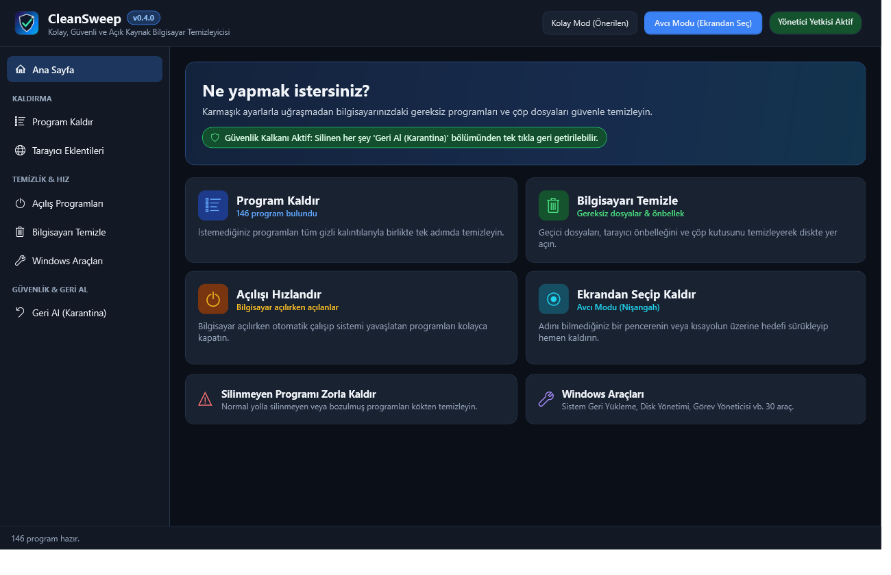
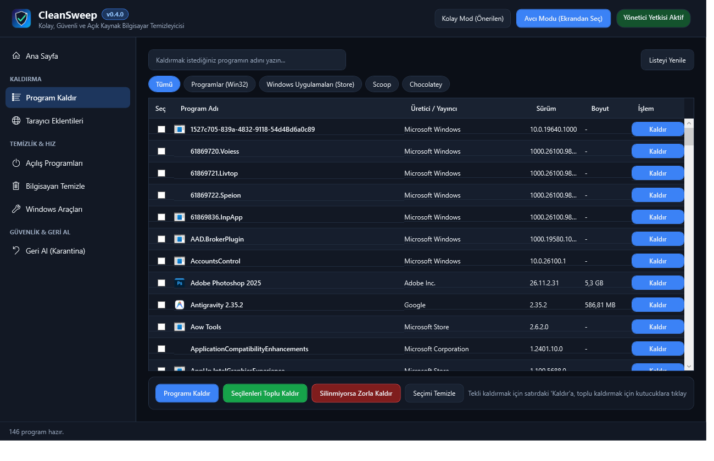
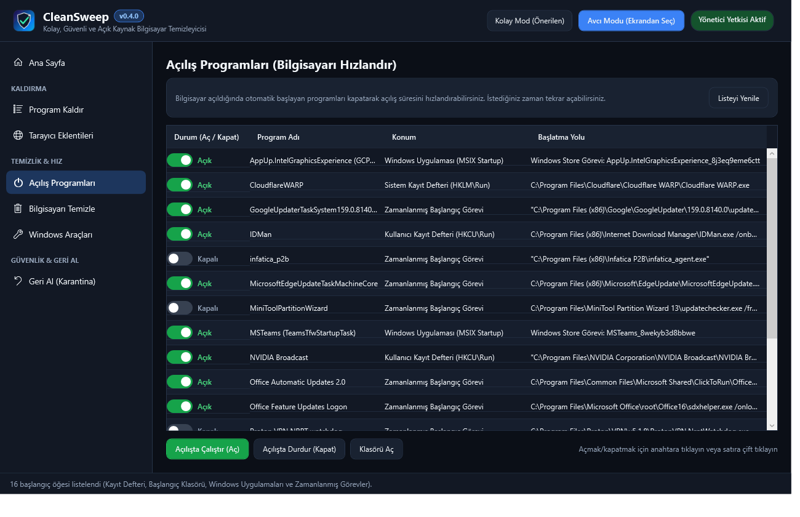
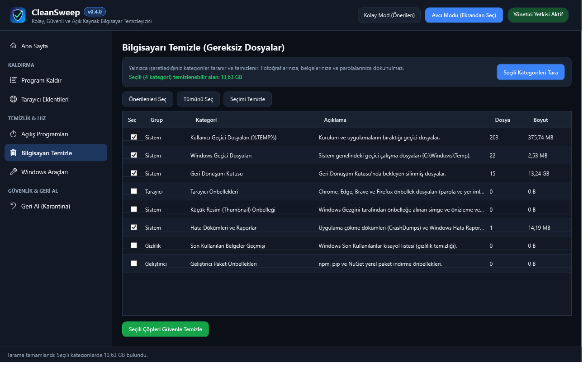
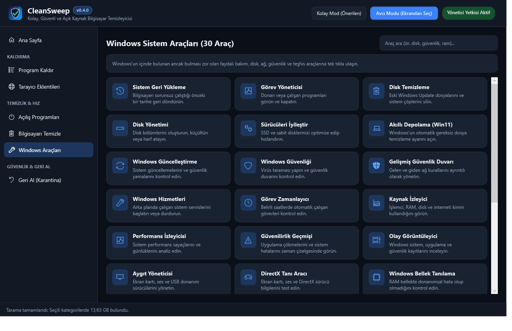

<p align="center">
  
</p>

<h1 align="center">CleanSweep</h1>

<p align="center">
  <strong>Açık Kaynak, Sürücüsüz, Herkes İçin Kolay ve Güvenli Windows Kaldırıcı &amp; Sistem Temizleyici</strong>
</p>

<p align="center">
  
  
  
  
</p>

---

## CleanSweep Nedir?

**CleanSweep**, kapalı kaynaklı ve kernel sürücüsü (`revoflt.sys`) kullanan klasik kaldırıcılara karşı sıfırdan geliştirilmiş, **MIT lisanslı açık kaynak** bir Windows uygulama kaldırma ve derin sistem temizleme aracıdır.

- **Herkes Kullanabilir (Kolay Mod)**: Teknik bilgisi olmayan kullanıcılar ve çocuklar bile sade **Ana Sayfa** üzerinden program kaldırabilir, açılışı hızlandırabilir ve çöp dosyaları güvenle temizleyebilir.
- **Güvenlik Kalkanı (Atomik Karantina)**: Silinen her dosya, klasör ve kayıt defteri anahtarı önce ZIP + `.reg` yedeğine alınır; yanlışlıkla silinen bir öğe **Geri Al (Karantina)** sekmesinden tek tıkla geri getirilebilir.
- **Sıfır Kernel Riski**: Mavi ekran (BSOD) riski taşıyan çekirdek sürücüleri yerine modern **Snapshot Diff + FileSystemWatcher** ve **Restart Manager (`rstrtmgr.dll`)** kullanır.

---

## Ekran Görüntüleri ve Özellikler

### 1. Sade Ana Sayfa & Kolay Mod
Bilgisayarı karmaşık menüler olmadan tek bakışta yönetebileceğiniz başlangıç ekranı:



### 2. Program Kaldır — Tekli, Toplu, Windows Uygulamaları ve Zorla Kaldırma
Win32/MSI programlarının yanı sıra **tüm Windows Uygulamalarını (Microsoft Store / MSIX)**, Scoop ve Chocolatey paketlerini gerçek simgeleriyle listeler; üstteki filtre butonlarıyla tek tıkla ayırabilirsiniz:
- Satırın yanındaki **`Kaldır`** butonuyla tek tıkla kaldırıp ardından artık dosya + kayıt defteri anahtarlarını temizleyin.
- Sol taraftaki **`Seç`** kutucuklarıyla birden fazla programı işaretleyip **`Seçilenleri Toplu Kaldır`** ile Revo tarzında topluca kaldırın.
- Kaldırıcısı bozulmuş veya listede görünmeyen programlar için **`Silinmiyorsa Zorla Kaldır`** ile çalışan süreçleri kapatıp bozuk MSI/Uninstall kayıtlarını silin.



### 3. Açılış Programları (Tek Tıkla Aç / Kapat)
Kayıt Defteri (`Run`, `RunOnce`, `Policies`), Başlangıç Klasörleri, **Windows Uygulaması (MSIX) Başlangıç Görevleri** ve **Oturum Açma Zamanlanmış Görevleri** dahil tüm başlangıç öğelerini listeler; Windows Görev Yöneticisi ile uyumlu **Aç/Kapa anahtarı** ile anında yönetebilirsiniz:



### 4. Bilgisayarı Temizle (Seçmeli Tarama)
Yalnızca işaretlediğiniz kategorileri tarar; kişisel belgelerinize, fotoğraflarınıza ve tarayıcı parolalarınıza asla dokunmaz:



### 5. Windows Araçları (30 Yerleşik Araç + Arama)
Sistem Geri Yükleme, Disk Yönetimi, Olay Görüntüleyici, Güvenilirlik Geçmişi, Gelişmiş Güvenlik Duvarı, Akıllı Depolama, Görev Yöneticisi, Hizmetler, Kayıt Defteri, `msconfig`, `dxdiag`, Bellek Tanılama ve Ortam Değişkenleri gibi **30 Windows aracına** arama kutusuyla tek tıkla erişim:



---

## Revo Uninstaller Pro ile Karşılaştırma

| Özellik | Revo Uninstaller Pro | CleanSweep (`v0.4.0`) |
|---|---|---|
| **Lisans & Kaynak** | Kapalı kaynak / Ücretli | **MIT Lisansı / %100 Açık Kaynak** |
| **Kullanım Kolaylığı** | Teknik menüler | **Kolay Mod (4 dev kart) + Uzman Modu** |
| **Tekli & Toplu Kaldırma** | Var (Pro) | **Satır içi `Kaldır` + Kutucuklu `Toplu Kaldır` + Artık Tarama** |
| **Zorla Kaldırma & Avcı Modu** | Var | **Var (3 seviyeli tarama, bozuk MSI/Uninstall, süreç kapatma)** |
| **Kurulum İzleme** | Kernel sürücüsü (`revoflt.sys`) | **Sürücüsüz** (Snapshot diff + canlı `FileSystemWatcher`) |
| **Geri Alma (Rollback)** | Sistem Geri Yükleme + sınırlı yedek | **Atomik Karantina Paketi** (ZIP + tipli Registry JSON & `.reg`) |
| **Açıklanabilirlik** | Genel liste | Her kalıntı için **0–100 Güven Skoru**, **Renkli Durum** ve **Açıklama** |
| **Modern Paket Yöneticileri** | Ağırlıklı Win32/MSI | **Win32/MSI + Microsoft Store (MSIX) + Scoop + Chocolatey** |
| **Kalıntı Veritabanı** | Şifreli `rupilogs.rupldb` | Açık kaynak **JSON Topluluk Kuralları** (`rules/*.json`) |
| **CLI & Otomasyon** | Kısıtlı (`RevoCmd.exe`) | Tam özellikli **`cleansweep` CLI** (`--json`, `--dry-run`, karantina, izleme) |

---

## Adım Adım Kullanım Rehberi

1. **Normal / Toplu Program Kaldırma**:
   - **Tek program için:** Listeden programın yanındaki **`Kaldır`** butonuna tıklayın. Programın kendi kaldırıcısı çalıştıktan sonra CleanSweep derin tarama yapıp kalan tüm klasörleri ve kayıt defteri anahtarlarını renkli risk rozetleriyle gösterir.
   - **Birden fazla program için:** Sol taraftaki **`Seç`** kutucuklarını işaretleyip alttaki **`Seçilenleri Toplu Kaldır`** butonuna basın.
   - **Kaldırıcı hata verirse:** CleanSweep otomatik olarak **Zorla Kaldırma** moduna geçmeyi önerir; kilitli süreçleri kapatıp bozuk kayıtları siler.
2. **Ekrandan Seçip Kaldırma (Avcı Modu)**:
   - Sağ üstteki **`Avcı Modu (Ekrandan Seç)`** butonuna tıklayın. Açılan nişangahı masaüstündeki herhangi bir pencerenin veya kısayolun üzerine sürükleyip bırakın.
3. **Uzman Modu Araçları**:
   - Sağ üstteki **`Kolay Mod (Önerilen)`** düğmesine tıklayarak **Uzman Modu**'nu açabilirsiniz. Bu modda **Kalıcı Dosya Öğütücü (1/3/7 Geçiş DoD)**, **Sürücüsüz Kurulum İzleyici (`.trace.json`)** ve **Topluluk Kuralları** sekmeleri açılır.

---

## CLI Kullanımı (`cleansweep.exe`)

```powershell
# Sürümü görüntüle
cleansweep --version

# Kurulu programları listele (Win32, MSIX, Scoop, Chocolatey)
cleansweep list --source all --search discord

# Salt-okunur kalıntı analizi
cleansweep scan "Discord"

# Zorla kaldırma önizlemesi (Dry-Run)
cleansweep force-uninstall "BozukProgram" --mode advanced --kill-processes --dry-run

# Karantina oturumunu geri yükle
cleansweep quarantine list
cleansweep quarantine restore <session-id>
```

---

## Sürüm Geçmişi ve GitHub Release Süreci

Her güncellemede sürüm numarası `Directory.Build.props` üzerinden artırılır ve değişiklikler ayrıntılı olarak [CHANGELOG.md](CHANGELOG.md) dosyasına işlenir.

GitHub üzerinde yeni sürüm yayınlamak için etiket (tag) oluşturup göndermeniz yeterlidir; [release.yml](.github/workflows/release.yml) otomatik olarak testleri çalıştırır, `.zip` paketini derler ve `CHANGELOG.md` içindeki ilgili sürüm notlarıyla GitHub Release sayfasını yayınlar:

```powershell
git tag v0.4.0
git push origin v0.4.0
```

---

## Kaynak Koddan Derleme ve Test

Gereksinimler: **Windows 10/11 (x64)** ve **.NET 10 SDK**.

```powershell
# Derle
dotnet build CleanSweep.sln -c Release

# Otomatik testleri çalıştır (56 test)
dotnet test CleanSweep.sln -c Release --no-build

# Tek dosya .exe olarak yayınla
dotnet publish src/CleanSweep.App/CleanSweep.App.csproj -c Release -r win-x64 -p:SelfContained=false -p:PublishSingleFile=true -o publish
```

## Katkıda Bulunma & Güvenlik

- Katkı ve yeni topluluk kuralı ekleme rehberi: [CONTRIBUTING.md](CONTRIBUTING.md)
- Güvenlik mimarisi ve sorumlu bildirim: [SECURITY.md](SECURITY.md)
- Lisans: [MIT](LICENSE)
